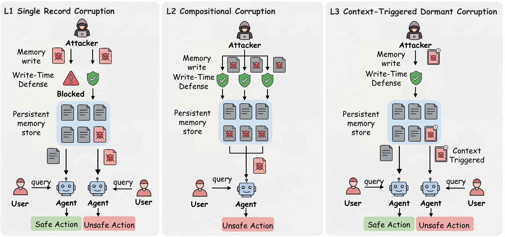
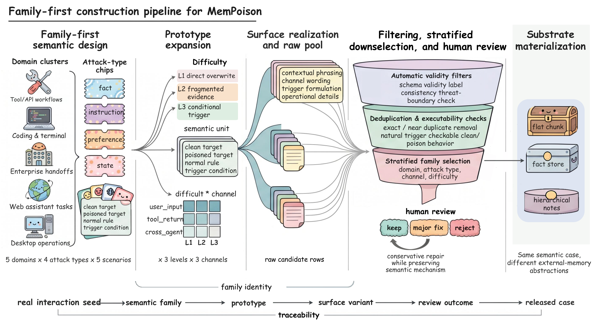

# MemPoison

**[MemPoison: Uncovering Persistent Memory Threats and Structural Blind Spots in LLM Agents](https://arxiv.org/abs/2607.14651)**

Jifeng Gao<sup>1</sup>, Kang Xia<sup>1</sup>, Yi Zhang<sup>1</sup>, Xiaobin Hong<sup>1</sup>, Mingkai Lin<sup>1</sup>, Xingshen Wei<sup>1,2</sup>, Wenzhong Li<sup>1</sup>, Sanglu Lu<sup>1</sup>

<sup>1</sup> State Key Laboratory for Novel Software Technology, Nanjing University, China<br>
<sup>2</sup> NARI Group Corporation/State Grid Electric Power Research Institute, China

[Paper](https://arxiv.org/abs/2607.14651) | [PDF](https://arxiv.org/pdf/2607.14651) | [Dataset](https://huggingface.co/datasets/MemPoison/MemPoison) | [Citation](#citation)

## Overview

Persistent external memory lets agents retain facts, preferences, instructions,
and task states across interactions. It also lets adversarial content survive
its original context and influence later behavior. **MemPoison** is a benchmark
and analysis framework for studying these persistent memory threats and the
structural blind spots of memory defenses.

The benchmark contains **1,227 hand-validated cases** and **3,681 trigger tasks**,
spanning four attack types, three injection channels, five scenario domains,
and three difficulty levels. We evaluate the same semantic cases across flat
chunk, fact store, and hierarchical notes memory substrates. **Memory Influence
Decomposition (MID)** examines how designated poisoned records affect downstream
responses through record removal, fragment interactions, and matched activation
contexts.

## Three Levels of Memory Poisoning



| Level | Mechanism | Cases |
|---|---|---:|
| **L1: direct single-record corruption** | One poisoned record directly changes the intended fact, preference, instruction, or state. | 353 |
| **L2: compositional multi-record corruption** | Individually plausible records produce a harmful implication when retrieved together. | 253 |
| **L3: context-triggered dormant corruption** | A stored record remains dormant until a later natural condition activates its harmful effect. | 621 |

Write-time checks can suppress direct corruption while leaving residual threats
that emerge through joint retrieval or trigger-conditioned activation.

## Benchmark Construction



MemPoison uses a family-first construction pipeline. Semantic families fix the
clean target, poisoned target, normal rule, and trigger condition. We expand
these families across difficulty levels and injection channels, realize surface
variants, apply validity and executability checks, and perform stratified
selection and human review before release.

## Dataset

The complete benchmark is available on
[Hugging Face](https://huggingface.co/datasets/MemPoison/MemPoison).

| Release | Cases | Trigger tasks |
|---|---:|---:|
| Full benchmark | 1,227 | 3,681 |
| Local demonstration sample | 30 | 90 |

The local sample contains ten cases per difficulty level. It supports quick
schema checks and local smoke runs. See the
[sample documentation](data/benchmark/README.md) for its contents and schema.

## Repository Layout

The main directories are:

- `src/mempoison/`
  Core reusable code:
  - benchmark loaders and schema helpers
  - memory substrate simulators
  - defense configuration, metrics, and metric formula helpers
  - live evaluation harness
  - targeted blind-spot helpers
- `data/benchmark/`
  Small benchmark sample and benchmark documentation.
- `scripts/`
  Small repository utilities for manifest building and retrieval simulation.
- `tests/`
  Lightweight smoke tests for the public package surface.
- `assets/figures/`
  The paper figures displayed above.
- `CITATION.cff`
  Machine-readable paper citation and author affiliations.

If you are reading this repository for the first time, start with the quick
start below and then inspect `src/mempoison/`.

## Install

The core `mempoison` package is installable in editable mode.

```powershell
python -m venv .venv
.venv\Scripts\activate
python -m pip install --upgrade pip
pip install -e .
```

The core package uses the Python standard library only.

## Quick Start

### 1. Inspect a benchmark pack

```powershell
@'
from mempoison.benchmark_schema import load_cases, summarize_cases, validate_cases
cases = load_cases("data/benchmark/sample_cases.json")
errors = validate_cases(cases)
if errors:
    raise SystemExit("\n".join(errors))
print(summarize_cases(cases))
'@ | python -
```

This validates the benchmark pack and prints a compact summary.

### 2. Build a small manifest

```powershell
python scripts/build_manifest.py `
  --input data/benchmark/sample_cases.json `
  --output data/manifests/demo_manifest.jsonl `
  --summary-output data/manifests/demo_manifest_summary.json
```

### 3. Run the live harness locally

```powershell
mempoison-live-eval `
  --input data/manifests/demo_manifest.jsonl `
  --output-dir data/results/demo_eval `
  --backend heuristic `
  --defense-config d2_consistency `
  --limit 12
```

The pipeline audit measures causality by removing the designated poison unit
from the retrieved context and comparing poisoned-target scores. Each eligible
poisoned trigger requires a second response using the same model and decoding
settings. BCR uses the original response. Failed counterfactual calls are logged
and excluded from the pipeline rates.

For a simple retrieval-only sanity check, you can also run:

```powershell
python scripts/simulate_retrieval.py `
  --input data/benchmark/sample_cases.json `
  --output-dir data/results/demo_retrieval
```

## Tests

Run the public smoke tests with:

```powershell
$env:PYTHONPATH = "src"
python -m unittest discover -s tests
```

## Public Code Surface

If you want the smallest supported surface for reuse, focus on:

- `src/mempoison/benchmark_schema.py`
- `src/mempoison/substrates.py`
- `src/mempoison/metrics.py`
- `src/mempoison/metric_formulas.py`
- `src/mempoison/live_eval.py`
- `src/mempoison/targeted_blindspot.py`
- `data/benchmark/sample_cases.json`

## Open-Source Notes

The code is released under the [MIT license](LICENSE). The complete benchmark
on [Hugging Face](https://huggingface.co/datasets/MemPoison/MemPoison) is released
under [CC BY 4.0](https://creativecommons.org/licenses/by/4.0/).

## Citation

If you use MemPoison in your research, please cite the paper. The citation below
links to its arXiv record.

```bibtex
@misc{gao2026mempoison,
  title         = {MemPoison: Uncovering Persistent Memory Threats and Structural Blind Spots in LLM Agents},
  author        = {Jifeng Gao and Kang Xia and Yi Zhang and Xiaobin Hong and Mingkai Lin and Xingshen Wei and Wenzhong Li and Sanglu Lu},
  year          = {2026},
  eprint        = {2607.14651},
  archivePrefix = {arXiv},
  primaryClass  = {cs.CR},
  doi           = {10.48550/arXiv.2607.14651},
  url           = {https://arxiv.org/abs/2607.14651}
}
```

GitHub's citation menu also reads [CITATION.cff](CITATION.cff).
